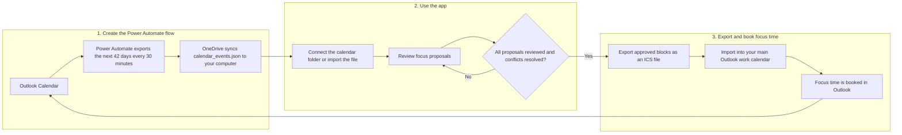

<h1>
  
  Focus Time Planner 1.0
</h1>

Protect time for meaningful work across the next six weeks. Focus Time Planner uses an Outlook calendar export to suggest focus blocks, lets you review and approve them, and creates an `.ics` file to import into Outlook.

I built this because I was tired of spending 60–80% of my day in meetings, and Microsoft Viva Insights only reserved focus time two weeks ahead. I wanted more control and a longer planning window.

The app runs locally in your browser. Power Automate and OneDrive keep its calendar file up to date; you book approved focus time by importing it into Outlook.

## End-to-end workflow



Once the updated calendar file contains your booked focus time, the app counts it toward your targets.

## 1. Creation of the Power Automate flow

Prerequisite: Set this up once. The flow reads your Outlook calendar every 30 minutes and updates a file in OneDrive for the app to read.

### Prepare OneDrive

1. Sign in to OneDrive for Business with your work account.
2. Create a folder named **CalendarExport**.
3. Inside that folder, create a plain-text file named **calendar_events.json**. For a new installation, enter `{}` as temporary content and save it. The flow will replace it on its first successful run; the placeholder cannot be loaded into the app. Keep an existing working calendar file if you already have one.
4. Sync the folder to your computer using the OneDrive desktop app.
5. In Windows File Explorer, right-click the folder and select **Always keep on this device**.

Your local file will typically be here:

```text
C:\Users\<username>\OneDrive - <organization>\CalendarExport\calendar_events.json
```

Use your own username and organization. Keep OneDrive running so cloud updates reach the local file. See [Links and further reading](#links-and-further-reading) for Microsoft's sync instructions.

### Build the scheduled flow

Open [Power Automate](https://make.powerautomate.com/) with your work account. Connect **Office 365 Outlook** and **OneDrive for Business** when prompted, then create a **Scheduled cloud flow** named **Focus Planner - Export calendar**.

Add these five steps in order. The expressions below are settings to paste into the designer's **Expression / fx** editor. Keep the action names shown, because later steps refer to them.

#### Step 1: Recurrence

| Setting | Value |
| --- | --- |
| Frequency | Minute |
| Interval | 30 |
| Time zone | Eastern Standard Time |

#### Step 2: Get calendar view of events (V3)

Add **Office 365 Outlook → Get calendar view of events (V3)**. Keep its action name as `Get_calendar_view_of_events_(V3)`.

| Field | Value |
| --- | --- |
| Calendar Id | Your main work calendar |
| Start Time | Expression: `startOfDay(utcNow())` |
| End Time | Expression: `addDays(utcNow(),42)` |

Use the calendar-view action so recurring meetings are included. Include all-day events, your time off, holidays, and existing focus reservations. Holidays on a separate calendar must also be present on the work calendar you export.

**Check calendar coverage:** this basic flow retrieves one page, and Microsoft limits this action to 256 events per request. If your six-week calendar exceeds that, extend retrieval using **Top Count** and **Skip Count** before relying on the planner. Compare meetings near the end of week six with Outlook to check that the export is complete. These basic date settings use UTC boundaries; check your first and last planning days too.

#### Step 3: Select

Add **Data Operation → Select** and keep the name `Select`.

Set **From** to this expression:

```text
body('Get_calendar_view_of_events_(V3)')?['value']
```

Enter these field names on the left and their expressions on the right:

| Field name | Expression |
| --- | --- |
| `id` | `item()?['id']` |
| `start` | `item()?['startWithTimeZone']` |
| `end` | `item()?['endWithTimeZone']` |
| `subject` | `item()?['subject']` |
| `showAs` | `item()?['showAs']` |
| `isAllDay` | `item()?['isAllDay']` |
| `isCancelled` | `item()?['isCancelled']` |
| `responseType` | `item()?['responseType']` |

Use the timezone-bearing start and end values exactly as shown so appointments appear at the correct times. The response field lets the app distinguish your own time off from teammates' invitations.

#### Step 4: Compose

Add **Data Operation → Compose** and keep the name `Compose`. Set **Inputs** to this expression:

```text
setProperty(
  setProperty(
    json('{}'),
    'generatedAt',
    utcNow()
  ),
  'events',
  body('Select')
)
```

#### Step 5: Update file

Add **OneDrive for Business → Update file**.

| Field | Value |
| --- | --- |
| File | Select `/CalendarExport/calendar_events.json` using the OneDrive picker |
| File Content | Expression: `string(outputs('Compose'))` |

Select the cloud file in Power Automate; the Windows path is used only when opening it on your computer. Reuse the same file on every run.

### Test the flow

1. Save the flow and select **Test → Manually**.
2. Confirm that all five steps succeed in run history.
3. Confirm that `calendar_events.json` updates in OneDrive and then in your local synced folder.
4. Load it in the app using the instructions below. Compare a few meetings, a recurring meeting in week six, your time off, and any existing focus reservations with Outlook.

The scheduled flow keeps running after you close the app. The app reads the synced file while it is open.

## 2. Using the App

### Open the app and connect your calendar

1. Download the repository using **Code → Download ZIP**, then extract it.
2. Keep the extracted app files together and open **index.html** in **Microsoft Edge** or **Google Chrome**.
3. Click **Connect calendar folder** and select your local **CalendarExport** folder. Allow read access when prompted.
4. The app loads `calendar_events.json` and generates focus proposals.

If folder access is unavailable, use **Choose File** under the calendar import option to load the file manually. Manual imports need to be repeated when you want newer calendar data.

When connected, the app checks the local file every minute while open and when you return to the window. **Refresh now** checks immediately; it does not run Power Automate. Allow time for both the scheduled export and OneDrive sync before expecting an Outlook change to appear. A red warning flags files more than 75 minutes old.

If the browser requests folder access again when reopening the app, click **Refresh now** and allow it, or reconnect the folder.

### Review and adjust your focus plan

Use **Calendar coverage** to scan the next six weeks. Each day shows its date, meeting percentage, focus status, and a timeline.

| Timeline color | Meaning |
| --- | --- |
| Grey | Meetings |
| Green | Focus time already booked in your calendar |
| Purple | Proposed focus time |

Select a day to see its calendar and focus blocks in the right-hand sidebar.

- **Approve** focus proposals you want to book, or **Reject** those you do not want.
- Use **Approve all proposals** when you are satisfied with all upcoming suggestions.
- Use **Add more focus time** to choose another available block.
- Use **Extend 30 min** to lengthen a future local block when space permits. Review and approve the revised block again.
- If new meetings overlap a planned block, review the affected day and dismiss the conflict before exporting.
- Use **Generate plan** to fill available gaps while keeping existing decisions.

Approvals are saved in the app; your Outlook calendar is booked in step 3.

### Understand the planning targets

Open **Planning preferences** in the header to see the rules.

| Preference | Behavior |
| --- | --- |
| Planning window | Six weeks, weekdays |
| Working hours | 9:30 AM–5:30 PM Eastern |
| Continuous focus goal | One uninterrupted two-hour block per working day |
| Days with 50% or less in meetings | Target at least four hours or half the available workday |
| Additional blocks | At least 60 minutes |
| Preferred focus time | Morning |
| Existing focus reservations | Count toward your target |
| Full-day PTO/OOO | No focus planning needed |

The app uses available gaps and shows shortfalls when a target cannot fit. Your own time off and shared closures reduce availability; teammates' personal PTO invitations are ignored when the export includes ownership information.

A green **All applicable focus days are fully planned** banner appears when the upcoming working days meet their targets and no proposals or conflicts remain. Read its message to see whether approved blocks still need exporting or the latest calendar file already contains the reservations.

### Save and reopen your plan

Changes save automatically in the same browser. **Save plan** explicitly saves your current calendar data, preferences, and decisions again.

Reopen the app at the same location in the same browser to restore the plan. Saving stays on that computer and browser; it does not book Outlook appointments or sync planning decisions between devices. Clearing browser data can remove the saved plan.

**Rebuild plan** clears local planning decisions after confirmation. App changes do not remove appointments you have already imported into Outlook.

## 3. Exporting to ICS and importing to Outlook

### Export approved focus time

1. Review every upcoming proposal: approve it or reject it.
2. Resolve or dismiss any remaining conflicts.
3. Click **Export to Outlook (.ics)**.
4. Choose a filename and save location when prompted.

The export button becomes available when there is at least one new approved future block and no outstanding proposals or conflicts. Existing Outlook focus reservations and blocks that have already started are excluded. Days without enough space for focus do not prevent exporting.

If your browser downloads automatically, check its Downloads folder. Enable **Ask where to save each file** in browser settings if you want a location prompt.

### Import into Outlook

In **Outlook on the web**:

1. Open **Calendar**.
2. Select **Add calendar → Upload from file**.
3. Browse to the saved `.ics` file.
4. Choose your **main work calendar**, the one colleagues use to check your availability.
5. Select **Import** or **Import and Save**, depending on the interface.
6. Check that the reservations appear at the expected times.

Imported appointments are titled **Focus Time**, marked **Busy**, and set to **Private**. They have no attendees.

### Refresh the app after booking

1. Wait for the next successful Power Automate run and OneDrive sync.
2. Return to the app and click **Refresh now**, or manually import the updated calendar file.
3. Confirm that the reservations appear as existing calendar focus.

The app counts these reservations toward your targets. When all applicable days are fully planned, the green completion banner confirms it. Additional suggestions can still appear if a day's target is not yet met.

**Import each export only once.** Reimporting can create duplicate appointments. This is a one-time calendar import: later edits or removals in the app do not update previously imported appointments. Make changes to those reservations in Outlook and refresh the app before planning again.

# Links and further reading

- [How to configure OneDrive sync on your computer](https://support.microsoft.com/en-us/onedrive/sync-your-computer-s-files-and-folders-with-onedrive)
- [Keep OneDrive files available on your device](https://support.microsoft.com/en-us/onedrive/save-disk-space-with-onedrive-files-on-demand-for-windows)
- [Create a scheduled Power Automate cloud flow](https://learn.microsoft.com/en-us/power-automate/run-scheduled-tasks)
- [Office 365 Outlook connector guidance and calendar retrieval limits](https://learn.microsoft.com/en-us/connectors/office365/)
- [Import an ICS calendar file into Outlook](https://support.microsoft.com/en-us/outlook/import-or-subscribe-to-a-calendar-in-outlook-com-or-outlook-on-the-web)


## License

Focus Time Planner is source-available under the [MIT License subject to the Commons Clause](LICENSE).

You may use it for free for personal and internal business purposes, and clone, modify, and share it under the license terms. Preserve the copyright and license notices, including the Commons Clause.

The license does not grant permission to sell the app, rebrand and resell it, or charge for a product or service whose value comes entirely or substantially from the app's functionality, including paid hosting or related consulting/support services covered by the Commons Clause. Those uses require separate written permission from Gordon Strodel. To request permission, [open a GitHub issue](https://github.com/gstrodel/focus-time-planner/issues/new).

This is a summary; the full terms in [LICENSE](LICENSE) govern.
